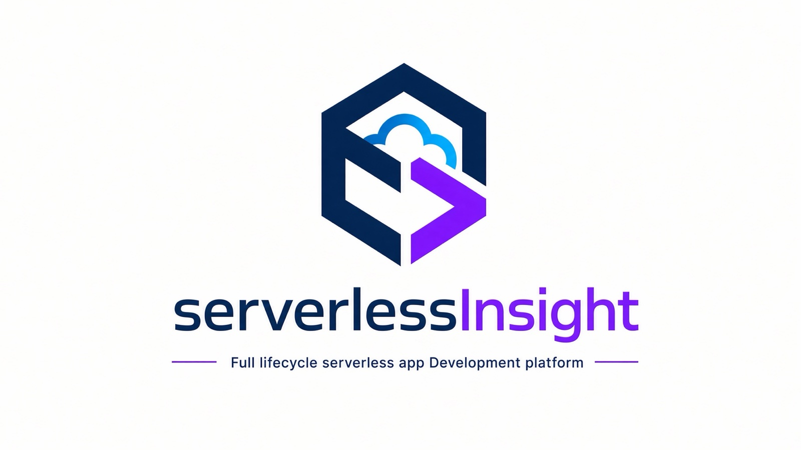

<div align="center">



# ServerlessInsight

**面向阿里云、腾讯云与火山引擎的全生命周期 Serverless IaC 工具。**

用一份 YAML 定义函数、API 网关、存储与数据库——先预览计划，再放心部署，并持续运维。

[](https://github.com/geek-fun/serverlessinsight/releases)
[](https://www.npmjs.com/package/@geek-fun/serverlessinsight)
[](https://www.npmjs.com/package/@geek-fun/serverlessinsight)
[](LICENSE)
[](https://github.com/geek-fun/serverlessinsight/actions/workflows/node.yml)
[](https://github.com/geek-fun/serverlessinsight/stargazers)
[](https://github.com/geek-fun/serverlessinsight/issues)

<p>
  = 22.12" />
  
</p>

<p>
  
  
  
</p>

[npm](https://www.npmjs.com/package/@geek-fun/serverlessinsight) · [文档](https://serverlessinsight.com/docs.html) · [官网](https://serverlessinsight.com) · [示例](samples) · [更新日志](CHANGELOG.md) · [Issues](https://github.com/geek-fun/serverlessinsight/issues)

简体中文 · [English](README.md)

</div>

---

ServerlessInsight（`si`）是一个开源的跨云 Serverless 框架。你不再需要分别应付各家云厂商的 CLI、控制台点击和一次性脚本——只需在单一 YAML 文件中描述整套 Serverless 技术栈（函数、HTTP 入口、对象存储、数据库与数据表），剩下的计划、部署与运维交给 `si`。

可以把它理解为面向 Serverless 的 Terraform：同一套声明式工作流，带状态追踪与漂移检测，专为函数、API 网关和 Serverless 数据服务而设计。无供应商锁定，Apache-2.0 许可。

**当前可部署：** 阿里云、腾讯云、火山引擎。华为云、AWS、Azure 与 Google Cloud 见[路线图](#路线图)。

## 目录

- [快速开始](#快速开始)
- [为什么选择 ServerlessInsight](#为什么选择-serverlessinsight)
- [功能特性](#功能特性)
- [支持的云服务商](#支持的云服务商)
- [文档](#文档)
- [路线图](#路线图)
- [架构](#架构)
- [开发](#开发)
- [社区](#社区)
- [贡献](#贡献)
- [赞助](#赞助)
- [许可证](#许可证)

## 快速开始

**需要 Node.js 22.12 或更高版本。**

```bash
npm install -g @geek-fun/serverlessinsight
si --version
```

创建 `serverlessinsight.yml`：

```yaml
version: 0.0.1

provider:
  name: aliyun
  region: cn-hongkong

app: hello-world
service: hello-world-api

functions:
  hello_function:
    name: hello-world-fn
    code:
      runtime: nodejs18
      handler: index.handler
      path: ./src
    memory: 512
    timeout: 10

events:
  api_gateway:
    type: API_GATEWAY
    name: my-api-gateway
    triggers:
      - method: GET
        path: /api/hello
        backend: ${functions.hello_function}
```

然后：

```bash
si validate                 # 按 IaC Schema 校验配置
si diff                     # 展示将要发生的变更，不写入状态
si deploy --stage prod      # 展示计划，确认后执行
si local                    # 在 http://localhost:4567 本地运行
si destroy --stage prod     # 删除 si 创建的全部资源
```

`si` 会自动发现当前目录下的 `serverlessinsight.yml`；其他文件名请用 `-f <path>` 指定。要切换云厂商，只需把 `provider.name` 改为 `tencent` 或 `volcengine`——运行时、触发器与资源会按对应云厂商映射为原生服务。

## 为什么选择 ServerlessInsight

- **Serverless 原生，而非通用 IaC。** 函数、触发器、API 网关、域名、存储桶、数据库与数据表都是一等资源，并带有云厂商感知的默认值——无需手写 Terraform 模块或 SDK 封装脚本。
- **一份 YAML 打通多云。** 同一套原语与 stage/变量体系适用于所有已支持的云厂商，切换云厂商只需改动 `provider.name`，而不是重写配置。
- **变更之前先看计划。** `si diff` 只读取状态与线上资源、不写入任何内容；`si deploy` 执行的正是你确认过的那份计划，控制台里的手工改动会以漂移形式暴露。
- **为自动化而生。** 日志输出到 stderr，机器可读结果输出到 stdout，每个 JSON envelope 都带版本号，错误码跨语言环境保持稳定，退出码遵循 Terraform 惯例。
- **真正可用的本地开发。** 用同一份配置在本地运行处理函数、HTTP 路由、定时调度与存储桶端点——无需云账号或凭证。
- **开源、无锁定。** Apache-2.0 许可，状态可存放在本地文件或你自己的存储桶中，不引入任何专有运行时。

## 功能特性

### 多云支持，统一配置

一次定义，即可部署到阿里云、腾讯云与火山引擎。运行时标识、cron 方言、网关资源与归属标签等厂商差异由框架负责解析，而不是由你的 YAML 承担。

- **统一配置** —— 所有云厂商共用同一 `serverlessinsight.yml` 格式
- **厂商专属映射** —— 运行时名称、触发器结构与资源类型会翻译为对应云平台的原生值
- **跨云感知** —— 同一套函数、存储桶、数据库与事件可在不同云之间通用

### 部署前预览

`si diff` 可预览阿里云、腾讯云与火山引擎上的全部变更。它会读取已配置的状态后端与线上云资源，但不应用变更、也不写入状态。

```bash
si diff --stage dev
si diff --stage dev --json
si diff --stage dev --region cn-beijing -p memory=1024
si diff --stage dev --no-refresh
```

使用 `-p, --parameter <key=value>` 可重复覆盖配置变量。`--no-refresh` 会跳过已追踪资源的线上漂移检查，新资源的归属探测仍会执行。需提前配置好凭证与所选状态后端；读取失败会以错误退出。迁移自旧版本的状态会产生告警并保持原样。

火山引擎的计划按依赖顺序包含函数、TOS 存储桶与 API Gateway 资源。

**退出码**：`si diff` 无变更时退出 `0`，有变更时退出 `2`（Terraform 惯例），出错时退出 `1`。`si validate` 校验通过退出 `0`，校验失败退出 `1`。

### 基础设施即代码

声明式 YAML 配置，内置校验、计划与状态管理，遵循成熟的 IaC 实践。

- **状态追踪** —— 基于 `.serverlessinsight/` 状态文件进行增量部署，支持本地、存储桶与 SaaS 后端
- **漂移检测** —— 在 `si` 之外被改动的资源会在下次部署前被标记出来
- **配置校验** —— 类型安全的模板校验在配置触达云端前捕获错误
- **部分失败恢复** —— 即使部分资源失败，已成功部署的资源仍会被保存；重试即可继续
- **状态锁** —— 阻止并发部署，必要时可用 `si force-unlock` 解锁

### 为 AI Agent 与脚本而设计

CLI 专为 Agent 与 Shell 脚本驱动而设计：日志始终输出到 **stderr**，结果数据输出到 **stdout**，因此把 stdout 管道给 `jq` 总能得到单个可解析的 JSON 文档。

```bash
si diff --json | jq '.summary'
si validate --json | jq '.valid'
si show --json | jq '.resourceCount'
si schema | jq '."$id"'   # IaC 格式的自包含 draft-07 JSON Schema
```

<details>
<summary><b>稳定的输出 envelope、错误码与颜色行为</b></summary>

稳定的输出 envelope（每个都带版本号字段，结构只会在新版本号下变化）：

- `si diff --json` → `{ planVersion: 1, provider, app, service, stage, changes: [{ logicalId, type, action: "create|update|destroy|recreate", attributes, drifted?, driftReasons? }], summary: { create, update, destroy, recreate, unchanged } }`
- `si validate --json` → `{ validateVersion: 1, valid, errors: [{ path, keyword, message, allowedValues? }] }`
- `si show --json` → `{ showVersion: 1, provider, app, service, stage, stateLocation, backend: "saas|bucket_store|local", locked, lock, resources, resourceCount, ... }`
- 失败时（`--json` 模式）→ stdout 输出 `{ error: { code, message } }`

稳定的错误码：错误 `code` 是翻译消息背后的 i18n key（例如 `RAM_ROLE_NOT_FOUND_IN_CLOUD`）——在所有语言环境下保持一致，Agent 可以据此映射自愈动作，不受 `LANG` 影响。

颜色：设置 `NO_COLOR` 环境变量（[no-color.org](https://no-color.org)）或传入 `--no-color` 时禁用 ANSI 颜色，保证非 TTY 环境下管道输出干净。

</details>

### 本地开发

无需部署到云端，也无需配置凭证，即可在本地运行和调试 Serverless 函数。

- **HTTP 函数** —— 为阿里云 FC、腾讯云 SCF 函数 URL 与火山引擎 veFaaS 提供原生的 event、context 与响应转换
- **定时触发器** —— `functions.*.triggers.timer` 调度按 UTC 墙钟执行，以对应云平台的 timer 事件形状调用你的处理函数
- **存储桶文件服务** —— 通过 HTTP 访问本地存储文件，加速迭代
- **监听模式** —— 代码变更后自动重载
- **同一配置，不同目标** —— `si local -s dev` 复用你现有的配置

支持范围与可运行示例详见[本地开发文档](docs/local-development.md)：[腾讯云 SCF](samples/tencent-local/serverlessinsight.yml) 与[火山引擎 veFaaS](samples/volcengine-local/serverlessinsight.yml)。

### API 网关与自定义域名

配置 HTTP 端点并绑定自定义域名，附带自动 DNS 验证。

- **HTTP 触发器** —— 使用 HTTP 方法与路径定义触发器，并指定后端函数
- **自定义域名** —— 阿里云 OSS 与 API 网关自动完成 CNAME + DNS TXT 所有权验证；腾讯云通过 DNSPod 托管域名
- **CDN 加速** —— 为静态站点提供边缘缓存与全球内容分发
- **OSS 传输加速** —— 通过阿里云骨干网进行跨区域数据传输
- **腾讯云函数 URL** —— 无需独立网关资源即可提供 HTTP 入口

### 定时触发器

在 `functions.*.triggers.timer` 下使用 provider 无关的 `si-cron` 表达式调度函数：

```yaml
functions:
  my_fn:
    triggers:
      timer:
        - name: billing-run            # 必填 —— 漂移检测按 name 定位
          cron: '0 23 3 * * *'         # 必填 —— si-cron，按 UTC 解释
          payload: '{"job":"billing-run"}'  # 可选，原样透传
          enable: true                 # 可选，默认 true
          description: 每日出账        # 可选
        - name: report-hourly
          cron: '@every 1h'
```

`cron` 支持标准 5 段表达式（`分 时 日 月 周`）、带秒前缀的 6 段，或 `@every <时长>`（`30s`、`5m`、`1h`、`1d` 等）。si-cron 一律按 **UTC** 解释——合成层负责翻译成各家方言（阿里云 FC3 六段、腾讯云 SCF 含年的七段、火山引擎 veFaaS 五段 crontab），并完成 UTC+8 字段平移，因此同一份 YAML 在所有云平台触发时刻一致。非法表达式与平台能力上限（腾讯云 SCF 单函数最多 10 个定时触发器）在 `si validate` 阶段即报错，不会进入部署。

<details>
<summary><b><code>triggers</code> 与顶层 <code>events</code> 的区分</b></summary>

`functions.*.triggers`（http、timer）是「调用本函数的东西」——函数级归属、随函数级联删除、没有独立配置面。顶层 `events`（如 `API_GATEWAY`）是拥有独立配置面的基础设施资源——自定义域名、证书、路由表——删除后端函数后它们依然存在。经验法则：有独立配置面 → `events`；纯调度/事件绑定 → `triggers`。

</details>

### 资源管理

不止于函数——管理包含存储、数据库与数据表在内的完整 Serverless 技术栈。

- **对象存储** —— OSS（阿里云）、COS（腾讯云）、TOS（火山引擎）
- **数据库** —— RDS MySQL Serverless、TDSQL-C 与 Elasticsearch Serverless
- **数据表** —— 阿里云 TableStore
- **GPU 函数** —— 在阿里云部署支持 GPU 的 Serverless 函数

## 支持的云服务商

| 云服务商         | 函数                       | HTTP 入口              | 对象存储 | 数据库与数据表                                                | 状态   |
| ---------------- | -------------------------- | ---------------------- | -------- | ------------------------------------------------------------- | ------ |
| **阿里云**       | ✅ FC3                     | ✅ API 网关            | ✅ OSS   | ✅ RDS MySQL Serverless、TableStore、Elasticsearch Serverless | 稳定   |
| **腾讯云**       | ✅ SCF                     | ✅ 函数 URL 触发器     | ✅ COS   | ✅ TDSQL-C、Elasticsearch Serverless                          | 稳定   |
| **火山引擎**     | ✅ veFaaS                  | ✅ API 网关            | ✅ TOS   | —                                                             | 稳定   |
| **华为云**       | ⚠️ 仅生成 Terraform 模板  | —                      | —        | —                                                             | 预览   |
| **AWS**          | —                          | —                      | —        | —                                                             | 计划中 |
| **Azure**        | —                          | —                      | —        | —                                                             | 计划中 |
| **Google Cloud** | —                          | —                      | —        | —                                                             | 计划中 |

说明：

- 华为云配置可被解析并生成 Terraform HCL 模板，但部署能力尚未实现。
- 腾讯云没有独立的 API 网关资源，HTTP 入口由函数 URL 触发器提供。
- 火山引擎暂不支持 Serverless 数据库与数据表。
- 资源级细节见[完整支持矩阵](https://serverlessinsight.com/reference.html)。

## 文档

| 资源             | 链接                                                          |
| ---------------- | ------------------------------------------------------------- |
| 快速入门         | <https://serverlessinsight.com/getting-started.html>          |
| 配置参考         | <https://serverlessinsight.com/reference.html>                |
| CLI 参考         | <https://serverlessinsight.com/cli.html>                      |
| JSON Schema      | `si schema`（自包含 draft-07）                                |
| 本地开发         | [docs/local-development.md](docs/local-development.md)        |
| 状态锁           | [docs/state-locking.md](docs/state-locking.md)                |
| 架构决策记录     | [docs/adr](docs/adr)                                          |
| 示例             | [samples](samples)                                            |
| 更新日志         | [CHANGELOG.md](CHANGELOG.md)                                  |
| 常见问题         | <https://serverlessinsight.com/faq.html>                      |

## 路线图

- 华为云函数部署（模板生成已就绪）
- AWS、Azure 与 Google Cloud 支持
- 腾讯云独立 API 网关资源
- 火山引擎 Serverless 数据库与数据表
- 更多 Serverless 资源与厂商能力

路线图仅表示方向，不构成承诺。欢迎通过 Issue 讨论优先级。

## 架构

ServerlessInsight 采用**函数式客户端架构**，将云厂商 SDK 与业务逻辑清晰分离：

```
┌─────────────────────────────────────────┐
│   Resource / Planner / Executor Layer   │  ← 与云厂商无关的业务逻辑
│   (纯函数，不引入 SDK)                    │
└─────────────────────────────────────────┘
                    ↓
┌─────────────────────────────────────────┐
│         Functional Client Layer          │  ← 封装的 SDK 操作
│ (aliyunClient、tencentClient、          │
│  volcengineClient)                       │
└─────────────────────────────────────────┘
                    ↓
┌─────────────────────────────────────────┐
│      Cloud Provider SDKs                 │  ← @alicloud/*、tencentcloud-*、@volcengine/*
└─────────────────────────────────────────┘
```

- **函数式且纯粹** —— 业务逻辑使用不可变数据的纯函数
- **SDK 封装** —— 云厂商 SDK 仅能通过客户端模块访问
- **函数式优先** —— 优先使用 `type` 而非 `interface`，优先函数而非类，采用声明式集合处理

## 开发

ServerlessInsight 基于 [Node.js](https://nodejs.org/) + [TypeScript](https://www.typescriptlang.org/)、[Commander.js](https://github.com/tj/commander.js/) CLI 构建，采用函数式架构。

### 前置要求

- **Node.js** >= 22.12
- **npm**（随 Node.js 附带）

### 从源码构建

```bash
git clone https://github.com/geek-fun/serverlessinsight.git
cd serverlessinsight
npm install
npm run build
npm link
```

### 脚本

| 命令                   | 说明                   |
| ---------------------- | ---------------------- |
| `npm run build`        | TypeScript 编译        |
| `npm test`             | 运行全部测试（含覆盖率） |
| `npm run test:unit`    | 仅单元测试             |
| `npm run test:service` | 仅服务测试             |
| `npm run test:ci`      | CI 测试运行            |
| `npm run lint:check`   | ESLint 检查            |
| `npm run lint:fix`     | 自动修复 lint 问题     |

测试分为两类：完全隔离并 Mock 外部依赖的快速单元测试，以及运行真实 parser、planner、executor 与状态管理器的服务测试。覆盖率门槛为分支、函数、行与语句四项均达到 85%。

### 项目结构

```
src/
├── commands/        # CLI 命令处理（deploy、destroy、diff、local 等）
├── common/          # 共享工具、客户端、状态与锁管理
│   ├── aliyunClient/
│   ├── tencentClient/
│   └── volcengineClient/
├── lang/            # 国际化文案（en.ts、zh-CN.ts）
├── parser/          # YAML 解析与校验
├── stack/           # 各云厂商资源逻辑
│   ├── aliyunStack/
│   ├── scfStack/            # 腾讯云
│   ├── volcengineStack/
│   ├── localStack/          # 本地开发服务
│   └── rfsStack/            # 华为云 Terraform 模板（预览）
├── types/           # TypeScript 类型定义
└── validator/       # JSON Schema 校验
tests/
├── fixtures/        # 测试夹具（YAML 配置、制品）
├── unit/            # 隔离的单元测试
└── service/         # 端到端服务测试
```

编码规范、测试规则与架构原则见 [AGENTS.md](AGENTS.md)。

## 社区

<p align="center">
  
</p>

<p align="center">
  <a href="https://x.com/geekfun_club"></a>
  &nbsp;&nbsp;&nbsp;
  <a href="https://www.youtube.com/@geekfun-club"></a>
  &nbsp;&nbsp;&nbsp;
  <a href="https://github.com/geek-fun"></a>
</p>

## 贡献

欢迎贡献——无论是缺陷反馈、功能建议、文档修正还是代码。

- 使用[缺陷报告](.github/ISSUE_TEMPLATE/bug_report.md)或[功能建议](.github/ISSUE_TEMPLATE/feature_request.md)模板提交 Issue。
- 提交 Pull Request 前，请运行 `npm run lint:check`、`npm run build` 与 `npm test`。
- 遵循 [AGENTS.md](AGENTS.md) 中的约定以及现有的 [Pull Request 模板](.github/PULL_REQUEST_TEMPLATE.md)。

## 赞助

<p align="center">
  
  &nbsp;&nbsp;&nbsp;&nbsp;&nbsp;
  <a href="https://github.com/sponsors/geek-fun"></a>
</p>

## 许可证

[Apache 2.0](LICENSE) © GEEKFUN
